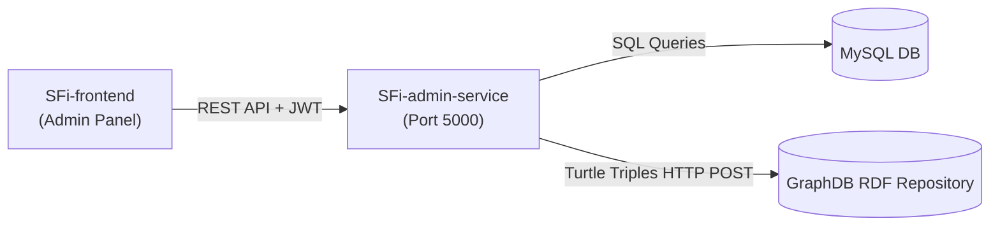

# 🛡️ SFi Admin & Ingestion Microservice

[](https://nodejs.org/)
[](https://expressjs.com/)
[](https://www.mysql.com/)
[](https://jwt.io/)
[](LICENSE)

**SFi-admin-service** is the backend REST API microservice responsible for administrator authentication, news article ingestion, staging, human-in-the-loop geocoding validation, and publishing verified disaster records directly into the **Ontotext GraphDB Knowledge Graph**.

---

## 🏛️ Architecture & Role in System



---

## 🛠️ Technology Stack

* **Runtime:** Node.js (v22+) — Native ES Modules (`"type": "module"`)
* **Web Framework:** Express.js 4.x
* **Database:** MySQL 8.x via `mysql2/promise` connection pooling
* **Authentication:** JSON Web Tokens (`jsonwebtoken`) & `bcryptjs`
* **HTTP Client:** Axios (for communicating with GraphDB REST Statements API)
* **Logger & Middleware:** `morgan`, `cors`, `dotenv`

---

## 📂 Project Structure

```text
SFi-admin-service/
├── database/
│   └── schema.sql              # MySQL DDL (Users, Articles, Locations, Impacts, Logs)
│
├── docs/
│   └── AGENT_PROMPT.md         # Full specification & instructions for AI Agents
│
├── src/
│   ├── config/
│   │   └── db.js               # MySQL connection pool configuration
│   ├── controllers/
│   │   ├── authController.js   # User registration, login, and profile
│   │   ├── articleController.js# Article CRUD and location validation logic
│   │   └── pipelineController.js# Triplification generator & GraphDB publishing
│   ├── middleware/
│   │   └── authMiddleware.js   # JWT verification middleware
│   ├── routes/
│   │   ├── authRoutes.js       # /api/auth endpoints
│   │   ├── articleRoutes.js    # /api/articles endpoints
│   │   └── pipelineRoutes.js   # /api/pipeline endpoints
│   └── server.js               # Express application entrypoint
│
├── .env.example                # Template for environment variables
└── package.json                # Project manifest and scripts
```

---

## 🔌 API Endpoints Summary

### Authentication (`/api/auth`)
| Method | Endpoint | Description | Auth Required |
| :--- | :--- | :--- | :---: |
| `POST` | `/api/auth/register` | Register a new operator/admin | No |
| `POST` | `/api/auth/login` | Login and receive JWT access token | No |
| `GET` | `/api/auth/me` | Retrieve current authenticated user profile | **Yes** |

### Articles & Staging (`/api/articles`)
| Method | Endpoint | Description | Auth Required |
| :--- | :--- | :--- | :---: |
| `GET` | `/api/articles` | List articles with pagination, status filter, and search | **Yes** |
| `GET` | `/api/articles/:id` | Get single article details with extracted locations & impacts | **Yes** |
| `POST` | `/api/articles` | Create or import a new flood news article | **Yes** |
| `PATCH`| `/api/articles/locations/:locationId` | Update location validation status, role (`FLOOD`/`EVACUATION`), or coordinates | **Yes** |

### Pipeline & GraphDB Publishing (`/api/pipeline`)
| Method | Endpoint | Description | Auth Required |
| :--- | :--- | :--- | :---: |
| `POST` | `/api/pipeline/publish/:articleId` | Convert validated article to RDF triples and push to GraphDB | **Yes** |
| `GET` | `/api/pipeline/health` | Check MySQL and GraphDB connectivity and counts | **Yes** |

---

## ⚡ Quick Start

### 1. Installation
```bash
cd SFi-admin-service
npm install
```

### 2. Configure Environment Variables
Copy `.env.example` to `.env` and fill in your database credentials:
```env
PORT=5000
DB_HOST=localhost
DB_PORT=3306
DB_USER=root
DB_PASSWORD=your_mysql_password
DB_NAME=semantic_flood_db

JWT_SECRET=your_jwt_secret_key
GRAPHDB_BASE_URL=http://localhost:7200
GRAPHDB_REPOSITORY=semantic-flood
```

### 3. Initialize MySQL Database
```bash
mysql -u root -p < database/schema.sql
```

### 4. Run Development Server
```bash
npm run dev
# Server will run on http://localhost:5000
# Health check available at http://localhost:5000/api/health
```

---

## 📄 License
This project is licensed under the MIT License.
