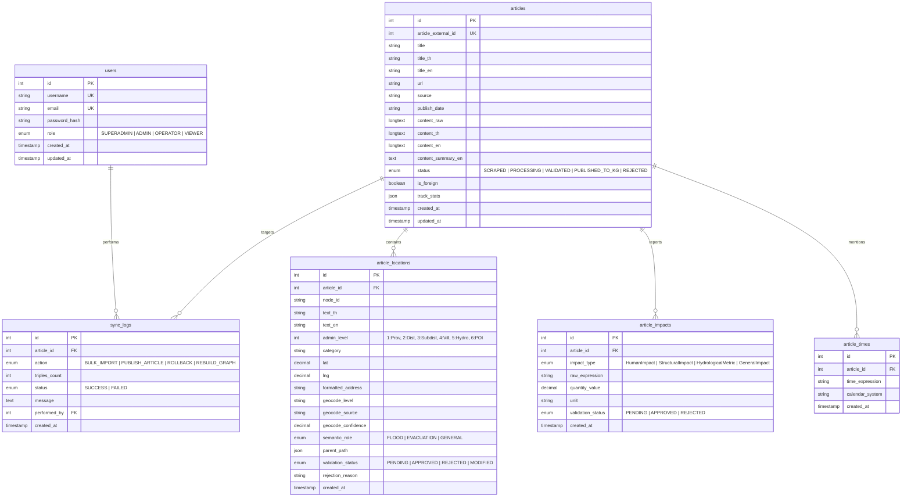

# 📚 SFi Database Dictionary & Schema Documentation

**Database Name:** `semantic_flood_db`  
**Engine:** MySQL 8.0+ (InnoDB)  
**Default Collation:** `utf8mb4_unicode_ci` (Full Unicode & Thai character support)  

---

## 🏛️ Entity Relationship Overview

---

## 📋 Detailed Table & Field Specifications

### 1. Table: `users`
Stores credentials and authorization roles for system operators and researchers.

| Column | Data Type | Nullable | Default | Description / Value Set |
| :--- | :--- | :---: | :---: | :--- |
| `id` | `INT` | ❌ No | Auto Increment | Primary Key. |
| `username` | `VARCHAR(50)` | ❌ No | - | Unique system username. |
| `email` | `VARCHAR(100)` | ❌ No | - | Unique email address for login. |
| `password_hash`| `VARCHAR(255)` | ❌ No | - | Bcrypt password hash (salt rounds $\ge 10$). |
| `role` | `ENUM` | ❌ No | `'OPERATOR'` | User role: `'SUPERADMIN'`, `'ADMIN'`, `'OPERATOR'`, `'VIEWER'`. |
| `created_at` | `TIMESTAMP` | ❌ No | `CURRENT_TIMESTAMP` | Account creation timestamp. |
| `updated_at` | `TIMESTAMP` | ❌ No | `CURRENT_TIMESTAMP` | Account last modification timestamp. |

---

### 2. Table: `articles`
Stores raw and staged disaster news reports.

| Column | Data Type | Nullable | Default | Description / Value Set |
| :--- | :--- | :---: | :---: | :--- |
| `id` | `INT` | ❌ No | Auto Increment | Primary Key. |
| `article_external_id` | `INT` | ✅ Yes | `NULL` | Original article ID from the NLP dataset (1–695). Unique. |
| `title` | `VARCHAR(500)` | ❌ No | - | Headline of the news article. |
| `title_th` | `VARCHAR(500)` | ✅ Yes | `NULL` | Original Thai headline. |
| `title_en` | `VARCHAR(500)` | ✅ Yes | `NULL` | English translated headline. |
| `url` | `VARCHAR(1000)`| ✅ Yes | `NULL` | Canonical source URL of the article. |
| `source` | `VARCHAR(100)` | ✅ Yes | `NULL` | News publisher / outlet (e.g. Matichon, DNP, ThaiPBS). |
| `publish_date` | `VARCHAR(50)` | ✅ Yes | `NULL` | Date of publication (ISO or string format). |
| `content_raw` | `LONGTEXT` | ✅ Yes | `NULL` | Original unparsed article body. |
| `content_th` | `LONGTEXT` | ✅ Yes | `NULL` | Full Thai article content. |
| `content_en` | `LONGTEXT` | ✅ Yes | `NULL` | Full English translated content. |
| `content_summary_en` | `TEXT` | ✅ Yes | `NULL` | Concise English disaster summary for KG. |
| `status` | `ENUM` | ❌ No | `'SCRAPED'` | Lifecycle status:  • `'SCRAPED'`: Newly scraped / pending NLP. • `'PROCESSING'`: Undergoing NER/geocoding. • `'VALIDATED'`: Approved by operator. • `'PUBLISHED_TO_KG'`: Triplified into GraphDB. • `'REJECTED'`: Duplicate or invalid article. |
| `is_foreign` | `BOOLEAN` | ❌ No | `FALSE` | `TRUE` if article covers international disasters (outside Thailand). |
| `track_stats` | `JSON` | ✅ Yes | `NULL` | Counts of NLP gazetteer, NER, and fused nodes. |
| `created_at` | `TIMESTAMP` | ❌ No | `CURRENT_TIMESTAMP` | Ingestion timestamp. |
| `updated_at` | `TIMESTAMP` | ❌ No | `CURRENT_TIMESTAMP` | Last updated timestamp. |

---

### 3. Table: `article_locations`
Stores geographical entities extracted from news text with geocoding and semantic role labels.

| Column | Data Type | Nullable | Default | Description / Value Set |
| :--- | :--- | :---: | :---: | :--- |
| `id` | `INT` | ❌ No | Auto Increment | Primary Key. |
| `article_id` | `INT` | ❌ No | - | Foreign Key referencing `articles(id)` (ON DELETE CASCADE). |
| `node_id` | `VARCHAR(100)` | ❌ No | - | Deterministic hash/identifier from geocoder pipeline. |
| `text_th` | `VARCHAR(255)` | ✅ Yes | `NULL` | Location name in Thai. |
| `text_en` | `VARCHAR(255)` | ✅ Yes | `NULL` | Canonical English location name. |
| `admin_level` | `INT` | ✅ Yes | `NULL` | Administrative level:  • `1`: Province (`flood:Province`) • `2`: District (`flood:District`) • `3`: Subdistrict (`flood:Subdistrict`) • `4`: Village (`flood:Village`) • `5`: Hydrological Body (`flood:HydroBody`) • `6`: POI / General Location |
| `category` | `VARCHAR(100)` | ✅ Yes | `NULL` | Type category (`PROVINCE`, `DISTRICT`, `CANAL`, `RIVER`, `HOTEL`, etc.). |
| `lat` | `DECIMAL(10, 7)`| ✅ Yes | `NULL` | Latitude coordinate (WGS84). |
| `lng` | `DECIMAL(10, 7)`| ✅ Yes | `NULL` | Longitude coordinate (WGS84). |
| `formatted_address`| `VARCHAR(500)`| ✅ Yes | `NULL` | Complete formatted reverse-geocoded address. |
| `geocode_level`| `VARCHAR(50)` | ✅ Yes | `NULL` | Geocoding match level (`EXACT_HIERARCHICAL`, `ADMIN_FALLBACK`, `UNRESOLVED`). |
| `geocode_source`| `VARCHAR(50)`| ✅ Yes | `NULL` | Source of geocode (`OSM_NOMINATIM`, `GAZETTEER`, `OVERPASS`). |
| `geocode_confidence`| `DECIMAL(5, 4)`| ✅ Yes | `NULL` | Confidence score (0.0000 to 1.0000). |
| `semantic_role`| `ENUM` | ❌ No | `'FLOOD'` | Semantic role in the disaster event:  • `'FLOOD'`: Inundation / submerged area (`hasLocation_Flood`). • `'EVACUATION'`: Shelter / safe refuge (`hasLocation_Evacuation`). • `'GENERAL'`: Mentioned contextually without hazard impact. |
| `parent_path` | `JSON` | ✅ Yes | `NULL` | Hierarchical parent chain (e.g. `["Songkhla Province"]`). |
| `validation_status`| `ENUM` | ❌ No | `'PENDING'` | Quality control status:  • `'PENDING'`: Awaiting review. • `'APPROVED'`: Validated for Knowledge Graph. • `'REJECTED'`: Toponym hallucination or out of bounds. • `'MODIFIED'`: Edited manually by admin. |
| `rejection_reason`| `VARCHAR(255)`| ✅ Yes | `NULL` | Reason for rejection (e.g. `FOREIGN_TOPONYM_REJECTED`, `NULL_COORDINATES`). |
| `created_at` | `TIMESTAMP` | ❌ No | `CURRENT_TIMESTAMP` | Creation timestamp. |

---

### 4. Table: `article_impacts`
Stores quantitative disaster damage metrics extracted from news reports.

| Column | Data Type | Nullable | Default | Description / Value Set |
| :--- | :--- | :---: | :---: | :--- |
| `id` | `INT` | ❌ No | Auto Increment | Primary Key. |
| `article_id` | `INT` | ❌ No | - | Foreign Key referencing `articles(id)` (ON DELETE CASCADE). |
| `impact_type` | `ENUM` | ❌ No | - | Impact classification:  • `'HumanImpact'`: Casualties, evacuees, victims, affected families. • `'StructuralImpact'`: Submerged homes, damaged bridges, inundated roads. • `'HydrologicalMetric'`: Water height (cm, m), rainfall volume (mm), flow rate. • `'GeneralImpact'`: Other quantitative mentions. |
| `raw_expression`| `VARCHAR(255)`| ❌ No | - | Raw text extracted from sentence (e.g. `"500 households"`, `"4 deaths"`). |
| `quantity_value`| `DECIMAL(15, 2)`| ✅ Yes | `NULL` | Parsed numeric value (e.g. `500.00`, `4.00`). |
| `unit` | `VARCHAR(50)` | ✅ Yes | `NULL` | Impact measurement unit (e.g. `"households"`, `"persons"`, `"m"`, `"cm"`). |
| `validation_status`| `ENUM` | ❌ No | `'APPROVED'` | Status: `'PENDING'`, `'APPROVED'`, `'REJECTED'`. |
| `created_at` | `TIMESTAMP` | ❌ No | `CURRENT_TIMESTAMP` | Record creation timestamp. |

---

### 5. Table: `article_times`
Stores temporal mentions and flood dates.

| Column | Data Type | Nullable | Default | Description / Value Set |
| :--- | :--- | :---: | :---: | :--- |
| `id` | `INT` | ❌ No | Auto Increment | Primary Key. |
| `article_id` | `INT` | ❌ No | - | Foreign Key referencing `articles(id)` (ON DELETE CASCADE). |
| `time_expression`| `VARCHAR(255)`| ❌ No | - | Temporal text expression (e.g. `"29 พฤศจิกายน"`, `"ช่วงบ่าย"`). |
| `calendar_system`| `VARCHAR(50)` | ✅ Yes | `NULL` | Calendar standard (`"BUDDHIST_ERA"`, `"GREGORIAN"`, `"SOLAR"`). |
| `created_at` | `TIMESTAMP` | ❌ No | `CURRENT_TIMESTAMP` | Record creation timestamp. |

---

### 6. Table: `sync_logs`
Provides an audit log of publishing actions and GraphDB synchronization.

| Column | Data Type | Nullable | Default | Description / Value Set |
| :--- | :--- | :---: | :---: | :--- |
| `id` | `INT` | ❌ No | Auto Increment | Primary Key. |
| `article_id` | `INT` | ✅ Yes | `NULL` | Foreign Key referencing `articles(id)` (ON DELETE SET NULL). |
| `action` | `ENUM` | ❌ No | - | Operation: `'BULK_IMPORT'`, `'PUBLISH_ARTICLE'`, `'ROLLBACK'`, `'REBUILD_GRAPH'`. |
| `triples_count`| `INT` | ❌ No | `0` | Number of RDF triples generated and pushed to GraphDB. |
| `status` | `ENUM` | ❌ No | - | Operation status: `'SUCCESS'`, `'FAILED'`. |
| `message` | `TEXT` | ✅ Yes | `NULL` | Diagnostic log or error message. |
| `performed_by`| `INT` | ✅ Yes | `NULL` | Foreign Key referencing `users(id)` (User who executed the action). |
| `created_at` | `TIMESTAMP` | ❌ No | `CURRENT_TIMESTAMP` | Log timestamp. |
